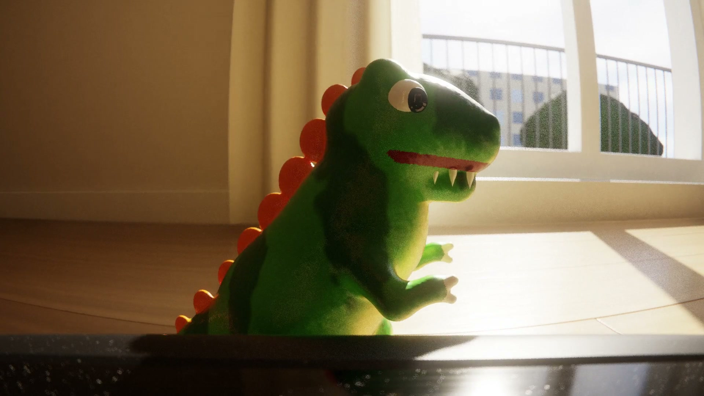
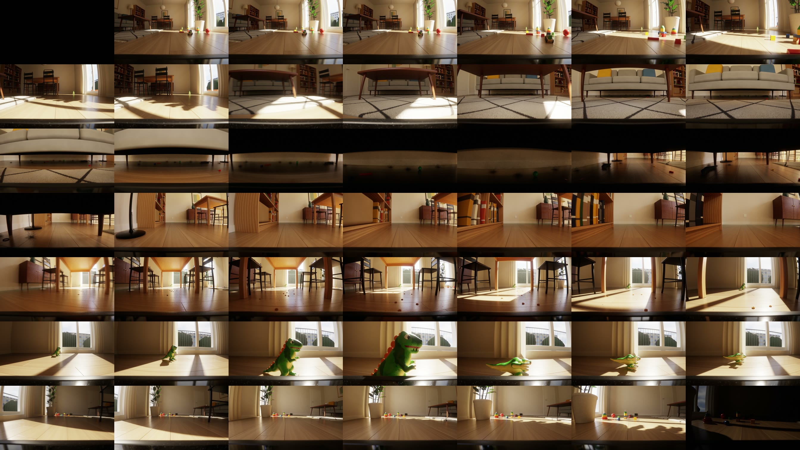

# Robot vacuum POV

A 53 second video that looks like footage from a camera on a robot vacuum, made only with code.



**Watch it:** [robovac-pov.mp4 in the latest release](../../releases/latest) (1920x1080, 30 fps, with sound, 113 MB)

No AI video model, no Blender or other 3D software, no textures, no 3D models, no recordings. About 2,400 lines of C++, Metal and Python. ffmpeg only encodes the frames.

Written by Claude Fable 5.2 in Cursor from a single request.



## How it works

| Part | File | What it does |
| --- | --- | --- |
| World | `src/scene.h`, `src/geom.h` | Builds the flat procedurally in C++: room, oak planks, furniture, books, plant, toys, the view outside. The rug is about 900,000 individual fibres. The T-Rex is a signed-distance shape turned into a mesh. |
| Robot and camera path | `src/path.h` | Simulates the robot at 240 Hz: drive and turn commands with acceleration limits, suspension over the rug edge, ticks on floorboard seams, vibration. Also the toy's shove, rocking and fall. |
| Renderer | `src/render.metal` | A path tracer in one Metal compute kernel, using the GPU's hardware ray tracing. Sun with soft shadows, sky light through the window openings, explicit sampling of sunlit surfaces, one traced bounce on top of a baked bounce-light grid, dusty air. Every material is procedural. |
| Host and camera | `src/main.mm` | Compiles the shader at run time, builds the acceleration structures, bakes the light grid, filters the soft indirect light, then applies the camera: lagging auto-exposure from a metering pre-pass, glare, chromatic aberration, vignette, tone curve, grain. Pipes frames to ffmpeg. |
| Sound | `src/audio.py` | Synthesises everything with numpy and scipy from the event timeline the simulation exports: fan, drive motors, seam ticks, rug thumps, cereal, the bump, the toy falling. |

The lens (112 degree stereographic), depth of field and 180 degree shutter blur are sampled per ray inside the renderer.

## Build and render

Needs an Apple Silicon Mac, the Xcode command line tools, ffmpeg and Python 3.

```bash
./build.sh                       # compiles ./robovac
./render.sh renders/v1.mp4 36    # full pipeline at 36 samples per pixel
```

The full render took 62 minutes on a MacBook Pro M5 (24 GB) with other GPU work running at the same time. Segments land in `work/seg/` and an interrupted render resumes where it stopped.

Useful while changing things:

```bash
./robovac --w 960 --h 540 --spp 16 --from 150 --to 150 --exposure 5 --frames out   # one frame from the robot camera
./robovac --eye 0.4 1.5 3.9 --at 4.0 0.4 1.5 --hfov 100 --exposure 5 --frames out  # free camera
./robovac --collide                                                                # route against the furniture
```

`--mode 1` to `--mode 5` show surface colour, normals, the light grid, direct light only and indirect light only.

## Known shortcomings

- The sound was balanced from loudness measurements and a spectrogram, not by ear.
- Under the sofa the picture stays dark for about 7 seconds. The auto-exposure is capped there on purpose, but it may feel long.
- Only the T-Rex reacts to the robot. The cereal and the dust it drives over stay where they are.
- The view through the windows is simple and mostly overexposed.
- Indirect light is one traced bounce plus a baked grid, so small contact shadows in deep shade are softer than they should be.

## Credit

The approach follows [Cat Garden](https://github.com/BubbleBrainBB/awesome-fable-5.2/tree/main/cat-garden) by BubbleBrain, a cat's-eye walk through a botanical garden made the same way. This project was made by reading how that one works and applying it to a different idea. The code here is new; it uses hardware ray tracing and a filtered bounce-light grid where Cat Garden uses its own BVH.

`PROMPT.md` has a self-contained prompt for making a video like this without a reference project.
